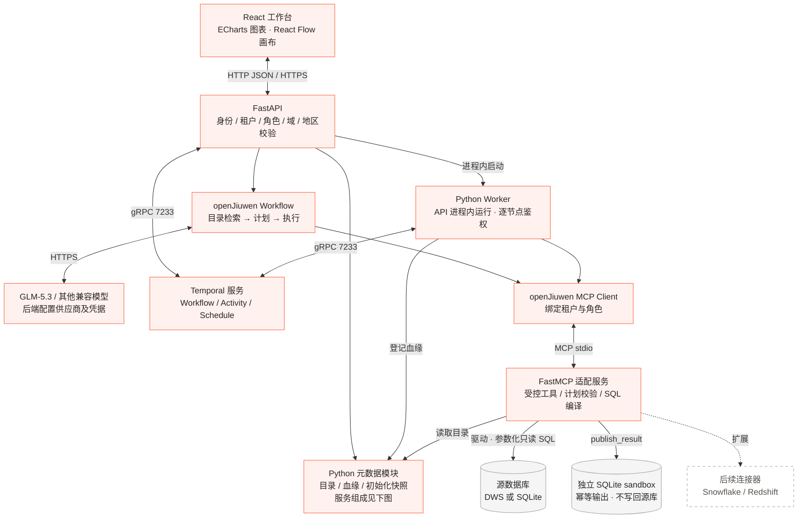
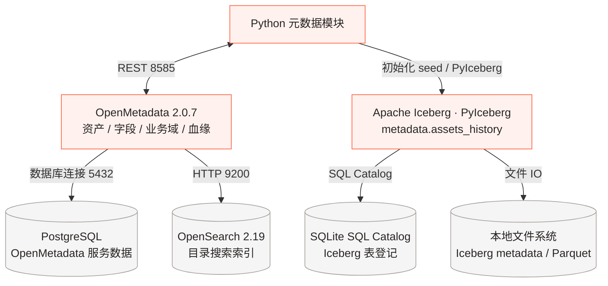
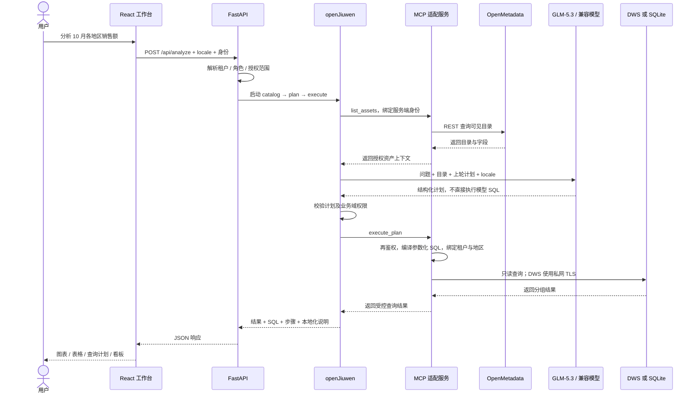

# Data Agent 架构、组件与连接方式

整体分为**统一交互、Agent 与权限、数据访问、元数据治理、后台任务**五部分。前端提交业务意图，openJiuwen 组织问数步骤，MCP 暴露受控工具，数据库驱动完成真实访问；统一目录与业务源数据分开管理。

以下实线表示完整集成模式已有实现的调用，虚线表示可配置的外部接口或后续扩展。图中包含本地/云端的可选组件，不代表安装 Skill 后全部服务已经启动。

## 1. 完整组件架构

OpenMetadata、PostgreSQL、OpenSearch 和 Temporal 在集成模式下由 Docker Compose 启动。API、openJiuwen 和 Worker 运行在 Python 环境；MCP 服务按调用创建绑定身份的子进程。上图是逻辑组件图，不要求每个框对应一台机器。

## 1.1 元数据服务子图

## 2. 分别用了什么组件

| 层次 | 组件 | 职责与当前实现 |
|---|---|---|
| 前端 | React 19、TypeScript、Vite | 六个工作台页面、三语言切换、对话与目录操作 |
| 可视化 | ECharts 6、React Flow 12 | 图表/看板，以及流程节点、连线与配置 |
| API | FastAPI、Uvicorn | 接收 JSON 请求、解析身份、返回分析与任务状态 |
| Agent | openJiuwen `Workflow`、`Model` | `catalog → plan → execute`；可配置模型生成结构化计划 |
| 模型 | Huawei MaaS `glm-5.3` | 默认模型；可替换供应商、模型名、base URL、key 和超时 |
| 工具协议 | openJiuwen MCP client、FastMCP | `list_assets`、`execute_plan`、`publish_result`；当前使用 stdio |
| 查询执行 | Pydantic、受控 SQL 编译器、psycopg2 / sqlite3 | 校验计划、参数绑定、租户与地区过滤、只读访问 |
| 数据平台 | DWS 或本地 SQLite | 通过 `DATA_BACKEND` 选择一个查询后端；不是按资产自动跨多库路由 |
| 统一目录 | OpenMetadata 2.0.7 | 资产、字段、租户命名空间、业务域与执行血缘 |
| 目录底座 | PostgreSQL、OpenSearch 2.19 | 分别存放 OpenMetadata 服务数据和检索索引 |
| 元数据历史 | Apache Iceberg、PyIceberg、PyArrow | 初始化时向 `metadata.assets_history` 追加资产身份快照 |
| 任务编排 | Temporal、Python Worker | 持久化流程/调度、Activity 执行、失败处理和质量检查 |
| 本地状态 | SQLite | 分别保存合成源表、任务状态、sandbox 输出、Iceberg Catalog 与 Temporal 开发状态，避免职责混用 |
| 权限 | Python `policy.py`、OIDC 验证、可选 OPA | 本地演示身份；服务端角色/域/地区校验；外部身份与策略扩展 |
| 云端入口 | Caddy、ECS、VPC；私有 OBS 交付部署包 | HTTPS 入口与私网 DWS；OBS 在当前方案中用于加密部署包交付 |

## 3. 组件大概怎么连接

| 连接 | 协议 / 方式 | 传递什么 |
|---|---|---|
| 浏览器 → FastAPI | HTTP + JSON；对外部署由 HTTPS 入口代理 | 问题、locale、流程定义、会话 Cookie / 身份令牌 |
| openJiuwen → 模型 | HTTPS，OpenAI-compatible API | 问题、授权资产上下文、结构化分析计划；模型密钥仅在后端 |
| Agent / Worker → MCP 服务 | **MCP over stdio**，本机子进程 | JSON 工具调用；身份由服务端通过子进程环境绑定 |
| MCP → DWS | **psycopg2，PostgreSQL 兼容协议 + TLS**，默认 8000 | 参数化只读 SQL 和查询结果；经私网访问 |
| MCP → 本地源库 / sandbox | Python sqlite3，进程内文件访问 | 源库只读；sandbox 按租户/目标/分区幂等写入 |
| Python 元数据模块 → OpenMetadata | REST API，默认 8585 | 目录与字段、资产/流程登记、血缘关系 |
| OpenMetadata → PostgreSQL / OpenSearch | 数据库连接 5432 / HTTP 9200 | 服务元数据持久化 / 目录搜索索引 |
| Python 元数据模块 → Iceberg | PyIceberg / PyArrow API | 资产身份历史记录；本地 SQL Catalog 和文件 IO |
| FastAPI / Worker → Temporal | Temporal SDK + gRPC，默认 7233 | 流程启动、调度注册、Activity 获取与执行结果 |
| 身份 / 外部策略 | OIDC JWT + JWKS / OPA REST API | 身份验证和附加授权决策；仅配置后启用 |

**MCP 与 JDBC 不处于同一层。** MCP 统一 Agent 调用工具的方式，数据库驱动负责访问具体平台。当前 DWS 使用 Python 的 psycopg2，无需 JDBC；以后可在 MCP 适配器后接原生 SDK 或 JDBC/Java 服务。当前 MCP 是包内适配服务，不是华为云托管 MCP 端点，也没有暴露任意 `execute_sql` 工具。

端口是样例默认值。开发服务绑定回环地址；容器之间通过内部网络访问。真实云端只开放应用 HTTPS，DWS、OpenMetadata、Temporal、搜索和 PostgreSQL 保持私有访问。

## 4. 一次 ChatBI 问数的调用顺序

无模型凭据时，只有 `DEMO_MODE=true` 允许使用明确标识的 `demo_rules`；非演示模式缺少模型配置会失败。未初始化 OpenMetadata 时，MCP 可退回包内受限资产清单，不能称为真实目录已接通。以上是集成后端时序，纯浏览器演示不经过这些服务。

## 5. 数据处理任务怎么下发

1. 用户通过自然语言模板或 React Flow 定义订单处理链：**读取 → 过滤 → 聚合 → 质量检查 → 发布**。
2. FastAPI 验证租户、执行权和流程结构，保存不可变流程版本，并通过 Temporal SDK 下发；定时任务使用 Temporal Schedule。
3. 当前 API 进程内启动 Python Worker，从 Temporal 获取工作并逐节点鉴权。聚合节点通过 MCP 查询源数据，质量失败则阻断发布。
4. 发布节点调用 MCP `publish_result`，只写独立 `outputs.db`，按 `(tenant, target, partition)` 幂等更新；不会写回 DWS 源表。
5. Worker 通过元数据模块把流程、派生资产及输入输出血缘登记到 OpenMetadata。执行日志和状态供工作台查询；关闭页面不停止已经启动的服务端任务。

浏览器模式的任务只在页面中模拟推进，不能替代 Temporal 持久任务。当前执行器只支持订单单链路，不支持任意 DAG 或任意业务代码。

## 6. 统一元数据放在哪里

**OpenMetadata 是当前统一管理目录，Iceberg 是历史表，两者职责不同。**

- OpenMetadata 管理资产、字段、租户命名空间、业务域和血缘；其服务数据由 PostgreSQL 保存，OpenSearch 提供检索索引。
- `backend.metadata.seed()` 初始化目录时，通过 PyIceberg 向 `metadata.assets_history` 追加快照。目前只有 `entity_id`、`name`、`fully_qualified_name`、`captured_at` 四列，尚不是全量字段、权限和血缘变更历史。
- Iceberg 当前使用本地 SQLite SQL Catalog，表的 metadata/Parquet 文件也在本地 `.runtime/iceberg/`。未部署 Polaris，也没有持续自动捕获全部元数据变更。
- 业务明细保留在 DWS 或本地演示源库，元数据统一不要求复制原表。后续可以扩展 Iceberg 历史 schema、事件同步、共享 Catalog 与对象存储，但这些不属于当前已完成能力。

## 7. 三种运行模式与后续扩展

| 模式 | 实际链路 | 用途 |
|---|---|---|
| 浏览器演示 | React → 合成 JSON + 规则聚合 + 浏览器状态 | 无账号快速体验；不运行 Python Agent、MCP 或开源后台服务 |
| 本地集成 | React → FastAPI → openJiuwen → MCP → SQLite；另启 OpenMetadata / Iceberg / Temporal | 验证真实 Agent、目录、权限与持久任务；模型可按需配置 |
| 华为云集成 | 浏览器 → Caddy HTTPS → ECS 上的 API/Worker/MCP；VPC 内连接 DWS，HTTPS 连接模型 | 需独立配置资源、凭据、证书和私网，并在目标环境重新验收 |

Snowflake、Redshift 的原生连接器、按逻辑资产选择多平台连接、跨平台联邦查询、Polaris、完整组织/IAM 生命周期和 DWS 发布写回，均属于扩展项。建议新增连接注册表：`逻辑资产 → 连接 ID → 物理位置 → 方言 / 工具能力`，再统一登记到 OpenMetadata；不能把尚未实现的多平台透明访问画成已连通。

## 8. 对应源码与操作指南

| 文件 | 对应职责 |
|---|---|
| [src/App.tsx](../assets/template/src/App.tsx)、[src/lib.ts](../assets/template/src/lib.ts) | 工作台、离线规则、目录/流程/任务交互 |
| [backend/api.py](../assets/template/backend/api.py)、[policy.py](../assets/template/backend/policy.py) | API、身份和服务端权限 |
| [backend/agent.py](../assets/template/backend/agent.py)、[planning.py](../assets/template/backend/planning.py) | openJiuwen Workflow、模型计划与 SQL 编译 |
| [backend/mcp_server.py](../assets/template/backend/mcp_server.py)、[database.py](../assets/template/backend/database.py) | 受控 MCP 工具与 DWS 连接 |
| [backend/metadata.py](../assets/template/backend/metadata.py) | OpenMetadata REST、Iceberg 初始化历史表 |
| [backend/jobs.py](../assets/template/backend/jobs.py) | Temporal Workflow/Activity、质量与输出血缘 |
| [infra/local-compose.yml](../assets/template/infra/local-compose.yml)、[runtime-compose.yml](../assets/template/infra/runtime-compose.yml) | 开源目录及持久任务开发服务 |

操作步骤：[本地启动](local-development.md) · [MCP 与 DWS](dws-mcp.md) · [模型与语言](models-and-locales.md) · [云端部署](cloud-deployment.md) · [验收](acceptance.md)。
