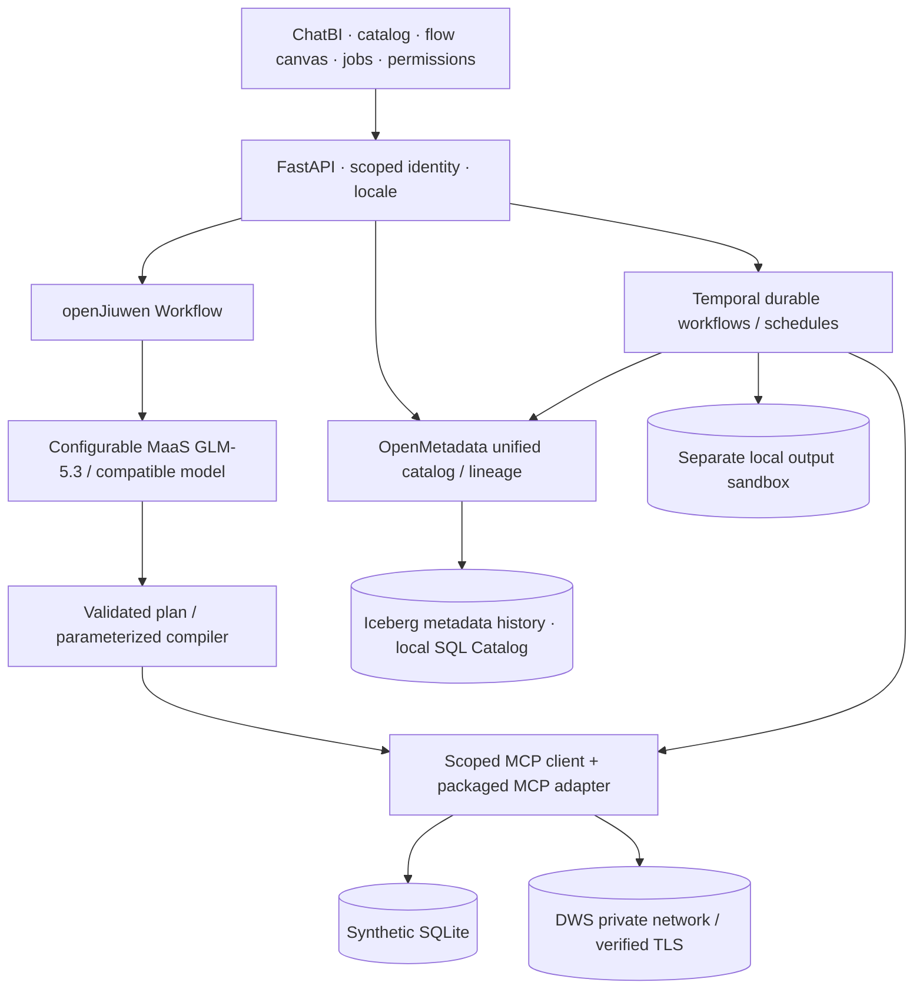

# Architecture and extension boundaries

The browser profile runs against a generated JSON mirror and labeled deterministic templates. It does not instantiate Python agent components. The integrated profile runs the actual openJiuwen → MCP path. Never equate local browser completion with a durable server task.

## Application map

| Path in generated project | Responsibility |
|---|---|
| `src/App.tsx`, `lib.ts` | ChatBI, catalog, flows, jobs, permissions, connector drafts; offline templates |
| `src/messages.json`, `i18n.ts`, `Locale.tsx` | Shared translations, persistent locale and font selection |
| `backend/agent.py`, `planning.py` | openJiuwen model/workflow, plan validation, safe SQL compilation |
| `backend/mcp_server.py`, `database.py` | Scoped tools, SQLite/DWS execution and TLS |
| `backend/policy.py`, `api.py` | Tenant/role/domain/region authorization and signed identity |
| `backend/metadata.py` | OpenMetadata API, asset registration, lineage, Iceberg snapshots |
| `backend/jobs.py` | Flow validation, Temporal worker, permissions per node, idempotent sandbox |
| `backend/access.py` | Optional standalone cloud demo password/invitation gate |
| `infra/*-compose.yml` | Loopback-only OpenMetadata/PostgreSQL/OpenSearch and Temporal development stack |
| `scripts/generate_data.py` | Reproducible fictional English data, CSV + SQLite + UI mirror |

## Metadata contract

OpenMetadata is the operational catalog: assets, physical locations, columns, domains, ownership context and lineage. Iceberg records queryable metadata history; it is not an automatic federation engine or a production catalog service. The current historical catalog uses SQLite locally; Polaris is not provisioned.

Keep a stable logical asset identifier separate from backend connection IDs and physical schema/table names. Extensions should add a connector registry mapping asset → connection → dialect/tool capabilities. Schema changes should update the catalog and invalidate dependent plans. Do not move warehouse tables into Iceberg merely to unify discovery.

## Adding a platform

The implemented query backends are SQLite and DWS. To add Snowflake/Redshift, add a connector with scoped credentials, TLS, cancellation/timeouts, dialect-aware parameter binding and column/type normalization. Expose its capabilities through MCP, then register assets in the same OpenMetadata catalog. MCP standardizes agent tool calls; vendor database drivers perform SQL execution. JDBC may be used behind a future Java adapter; it is not required for the Python DWS implementation.

Cross-platform joins are not implemented. A future federated planner needs explicit cost, movement and authorization rules. Keep unsupported operations explicit instead of claiming transparent execution across every platform.

## Security and execution

The backend binds tenant and persona before creating MCP tools. Plans use enumerated metrics, dimensions and date ranges; warehouse identifiers never come directly from free-form prompts. Regional managers stay within Mexico City and Sales; export, execution and governance are separate permissions. Subject changes must clear cached results and task views.

Source data is read-only during analysis. Processing supports one linear orders pipeline with quality checks. Publication is an independent local sandbox, with `(tenant, target, partition)` idempotence, followed by catalog/lineage registration. A real external publication adapter must define transactional behavior and privileges before allowing warehouse writes.
